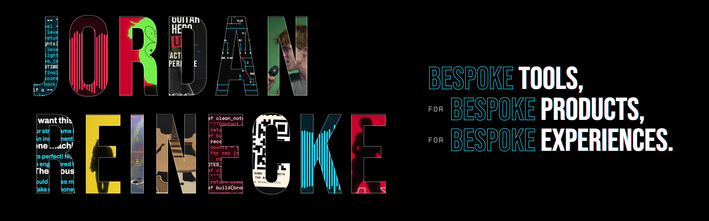

<picture>
  <source media="(prefers-color-scheme: light)" srcset="banner-light.png">
  
</picture>

Creative technologist, multimedia artist, video editor and agentic coder from Richmond, VA. I build workflow automation with AI agents so there's more room for human creativity and more stories get told.

I design, direct, test and decide what ships. AI coding agents (Claude Code, Codex) write most of the code.

### Projects

- **[ghl-stage-manager](https://github.com/MTADTA/ghl-stage-manager)**: the software behind Guitar Hero Live, my live show where the crowd joins the band. A Python REST/JSON server, phone sign-up and queue, a live Top 5 board, a stage-control panel and DMX lighting cues driven by the game.
- **[media-engine](https://github.com/MTADTA/media-engine)**: a multi-brand short-form media pipeline, from inbox to scheduled posts and back: ingest, caption, plan, review, publish, measure, recycle. Standard-library Python, dry-run by default, approvals bound to a hash of exactly what was approved.
- **[supercaster](https://github.com/MTADTA/supercaster)**: the guitar I play, designed in code. Parametric neck and body models, a three.js neck viewer, a vibroacoustic body model and a checker for all 60 switch states.

### Music

I write, sing and play lead guitar as Jordan Rein, signed to Shockoe Records.

[jordan@jordanreinmusic.com](mailto:jordan@jordanreinmusic.com) · [Music site](https://www.jordanreinmusic.com/) · [YouTube](https://www.youtube.com/@Jordanreinmusic)
